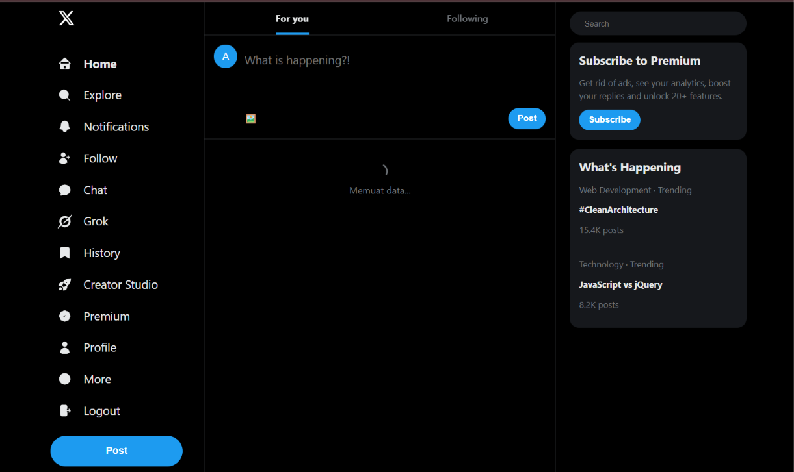
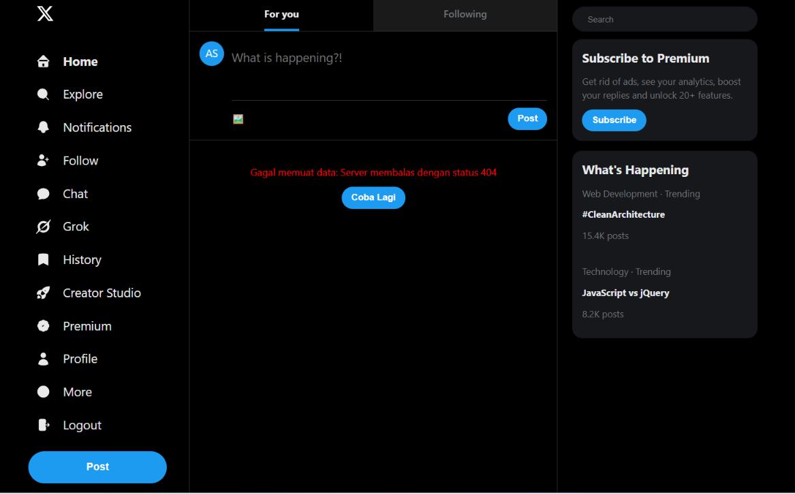

# APLIKASI X

Aplikasi tiruan tampilan media sosial X yang saya buat pakai React dan TypeScript. Di tugas ini saya menambahkan fitur ambil dan kirim data ke API pakai fetch(), lengkap dengan kondisi loading, success, dan error.

Repository: https://github.com/napisang/TugasMingguan_pengweb_X

## 1. Endpoint API

- GET https://dummyjson.com/comments?limit=15 : untuk mengisi feed. Datanya komentar pendek dengan isi teks, jumlah like, dan data penulis, jadi cocok jadi postingan.
- POST https://dummyjson.com/comments/add : untuk bikin postingan baru. Datanya nggak benar-benar tersimpan, jadi aman buat latihan.
- GET https://jsonplaceholder.typicode.com/users : untuk mengecek koneksi ke server saat login.

Ketiganya gratis, nggak perlu daftar, dan mendukung CORS. Nama pengguna di feed bukan dari API, tapi dipilih dari daftar NAMA_INDO lewat fungsi namaIndo() berdasarkan user.id.

## 2. Loading dan Error (src/pages/Home.tsx)

- State `status` ('loading', 'success', atau 'error', awalnya 'loading') menentukan tampilan, jadi ketiganya nggak muncul bersamaan.
- `getPosts()` menjalankan fetch() dan mengecek `res.ok` manual, karena fetch() nggak menganggap 404 sebagai error.
- `loadPosts()` memanggil getPosts(). Kalau berhasil, status jadi 'success'. Kalau gagal, pesan disimpan di `errorMessage` dan status jadi 'error'.
- `useEffect` memanggil loadPosts() sekali saat halaman dibuka.
- Tampilan memakai render kondisional: spinner saat loading, pesan error dan tombol "Coba Lagi" saat error, dan daftar lewat `apiPosts.map()` dengan `key={p.id}` saat success.
- `handleRetry()` mengembalikan status ke 'loading' lalu memanggil loadPosts() lagi.
- `handlePost()` mengirim POST. `isPosting` menonaktifkan tombol saat proses, dan `postError` menampilkan pesan kalau gagal.

## 3. Tangkapan Layar

### Loading

### Success

### Error

Loading saya tampilkan dengan menahan data beberapa detik, dan error dengan mengubah URL endpoint jadi salah. Keduanya sudah dikembalikan seperti semula.