# APLIKASI X

Aplikasi tiruan tampilan media sosial X yang saya buat pakai React dan TypeScript. Di tugas ini saya menambahkan fitur ambil dan kirim data ke API pakai fetch(), lengkap dengan kondisi loading, success, dan error.

Repository: https://github.com/napisang/TugasMingguan_pengweb_X

## 1. Endpoint API

- GET https://dummyjson.com/comments?limit=15 : untuk mengisi feed. Datanya buat komentar pendek dengan isi teks, jumlah like, dan data penulis, jadi cocok jadi postingan.
- POST https://dummyjson.com/comments/add : untuk bikin postingan baru. Datanya ga benar benar tersimpan, jadi aman sperti buat latihan
- GET https://jsonplaceholder.typicode.com/users : untuk mengecek koneksi ke server saat login.

Ketiganya gratis, ga perlu daftar, dan mendukung CORS. Nama pengguna di feed bukan dari API
## 2. Loading dan Error (src/pages/Home.tsx)

- State `status` ('loading', 'success', atau 'error', awalnya 'loading') menentukan tampilan, jadi ketiganya ga muncul bersamaan.
- `getPosts()` menjalankan fetch() dan mengecek `res.ok` manual, karena fetch() ga menganggap 404 sebagai error.
- `loadPosts()` memanggil getPosts(). Kalau berhasil, status jadi 'success'. Kalau gagal, pesan disimpan di `errorMessage` dan status jadi 'error'.
- `useEffect` memanggil loadPosts() sekali saat halaman dibuka.
- Tampilan memakai render kondisional: spinner saat loading, pesan error dan tombol "Coba Lagi" saat error, dan daftar lewat `apiPosts.map()` dengan `key={p.id}` saat success.
- `handleRetry()` mengembalikan status ke 'loading' lalu memanggil loadPosts() lagi.
- `handlePost()` mengirim POST. `isPosting` menonaktifkan tombol saat proses, dan `postError` menampilkan pesan kalau gagal.

## 3. Tangkapan Layar

### Loading
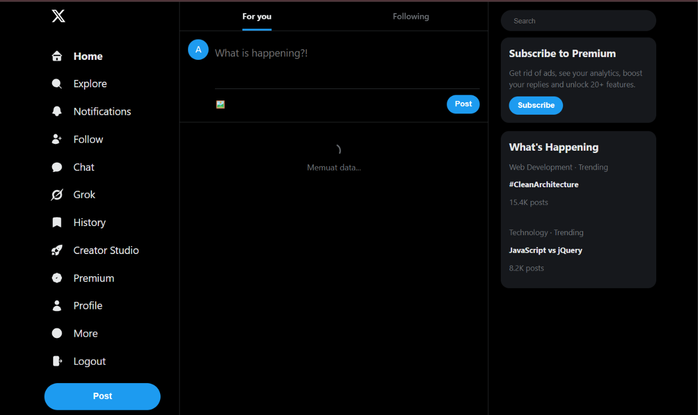

### Success
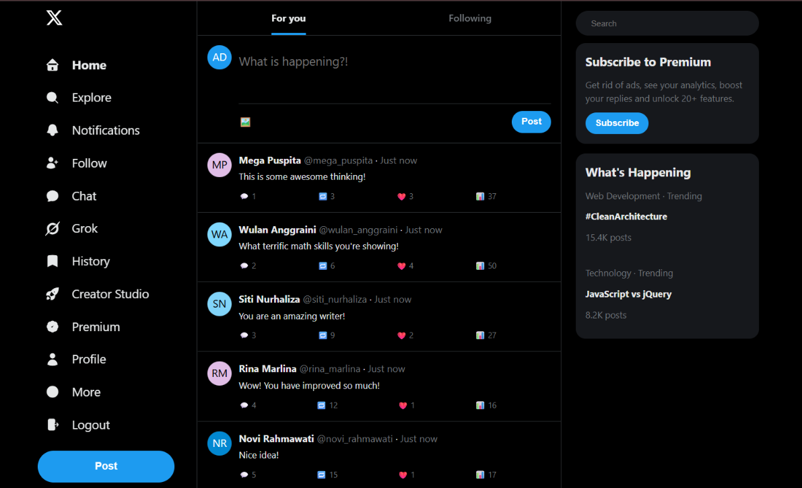

### Error
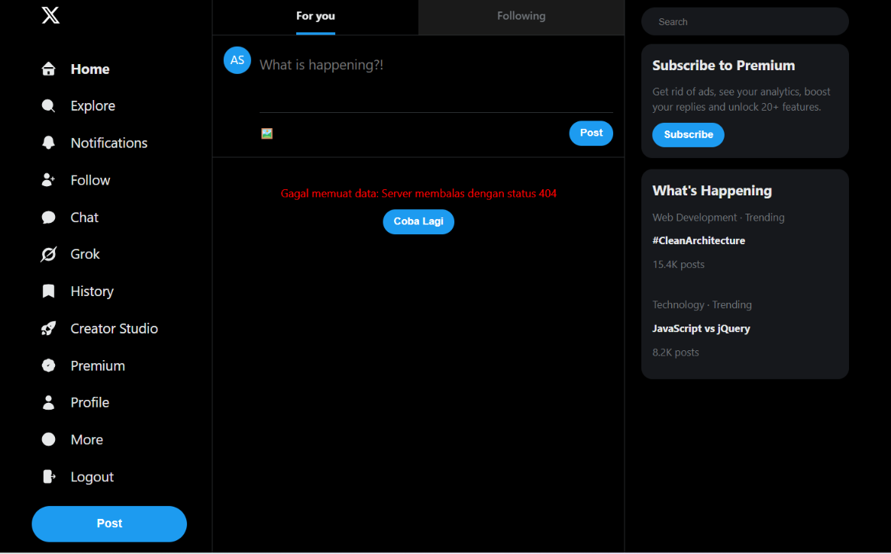

Loading saya tampilkan dengan menahan data beberapa detik, dan error dengan mengubah URL endpoint jadi salah. Keduanya sudah dikembalikan seperti semula.

---

## 4. Tugas Mingguan 10 – REST API, PostgreSQL dan Prisma ORM

Pada tugas ini saya melanjutkan pengembangan aplikasi X
dengan membuat backend sendiri menggunakan NestJS,
Prisma ORM, dan PostgreSQL.

API DummyJSON untuk postingan diganti dengan REST API
lokal agar postingan dapat disimpan ke dalam database.

### Teknologi yang Digunakan

- React
- TypeScript
- Vite
- NestJS
- Prisma ORM
- PostgreSQL
- REST API

### Endpoint API

- GET http://localhost:3000/posts
  Untuk menampilkan daftar postingan.

- POST http://localhost:3000/posts
  Untuk membuat dan menyimpan postingan baru.

### Database

- Database: x_db
- DBMS: PostgreSQL
- ORM: Prisma

### Menjalankan Backend

cd backend
npm install
npx prisma generate
npx prisma migrate deploy
npm run start:dev

### Menjalankan Frontend

npm install
npm run dev

### Hasil Implementasi

- Frontend terhubung dengan backend NestJS.
- Postingan dapat diambil melalui REST API.
- Postingan baru dapat disimpan ke database.
- Tampilan aplikasi mendukung desktop dan mobile.

### Tahapan Implementasi

#### Database PostgreSQL
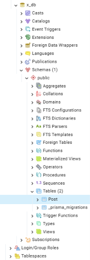

#### Pembuatan Backend NestJS
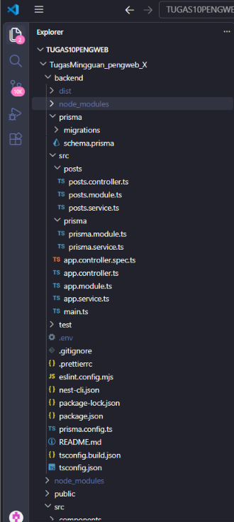

#### Prisma Schema
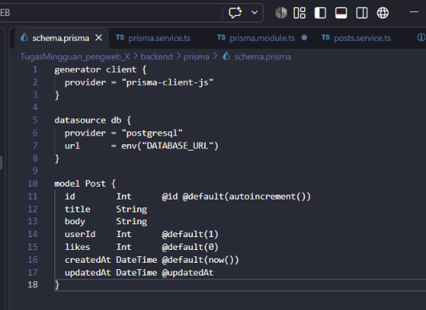

#### Migrasi Database
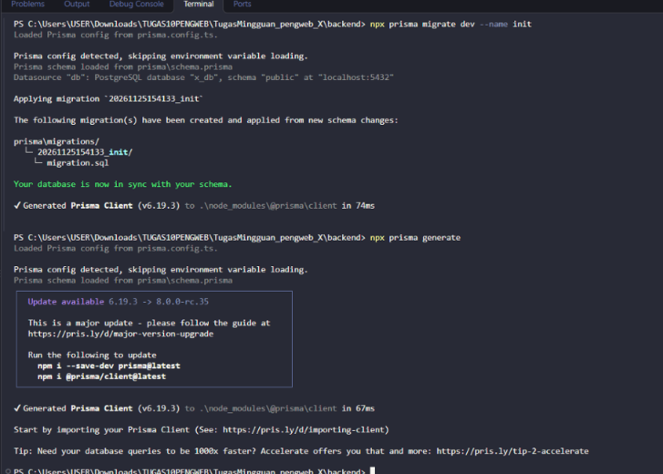

#### Menjalankan Backend
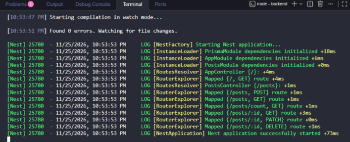

### Tampilan Aplikasi

#### Desktop
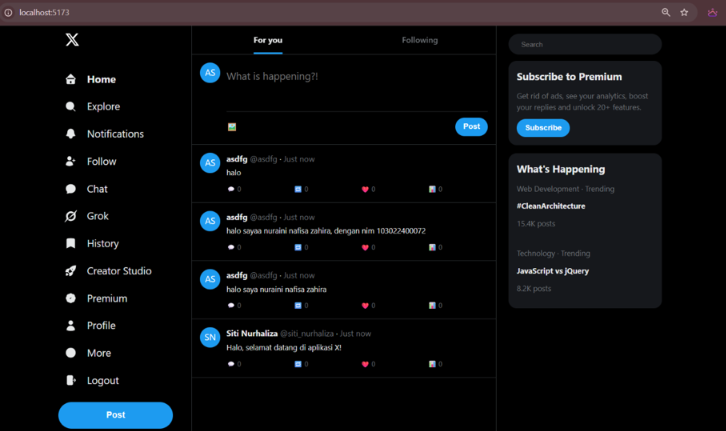

#### Mobile
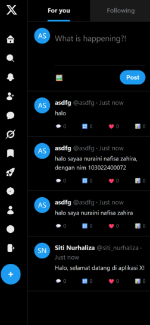

#### Hasil Build
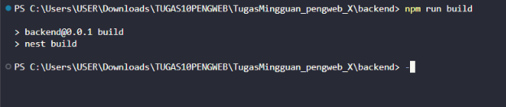
